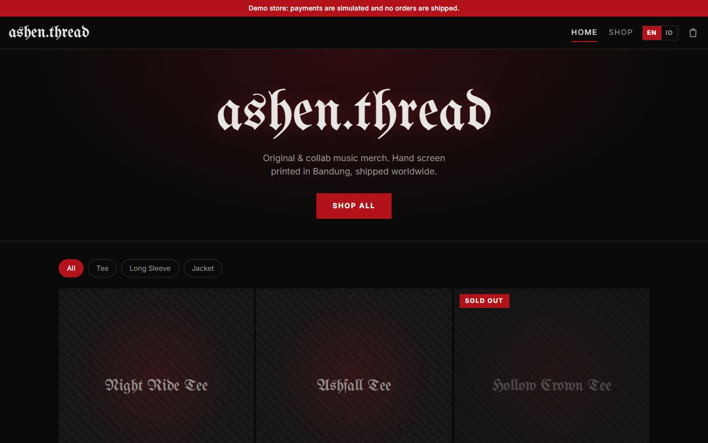
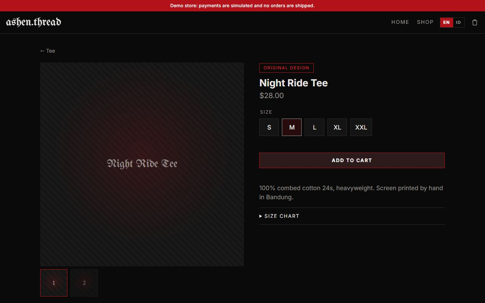
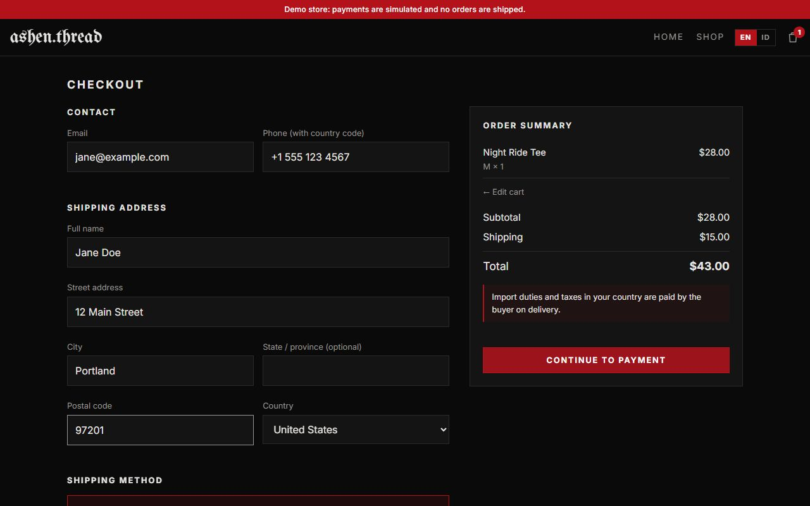
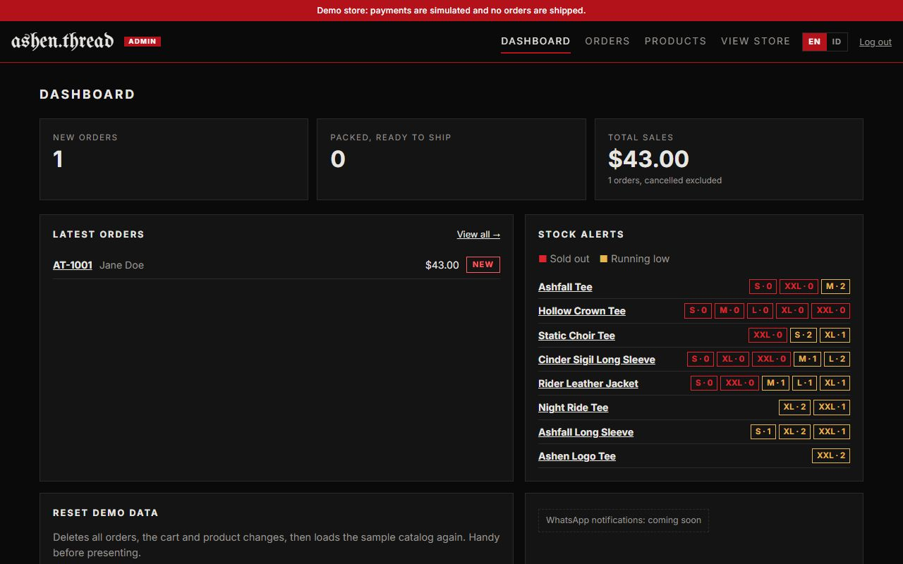
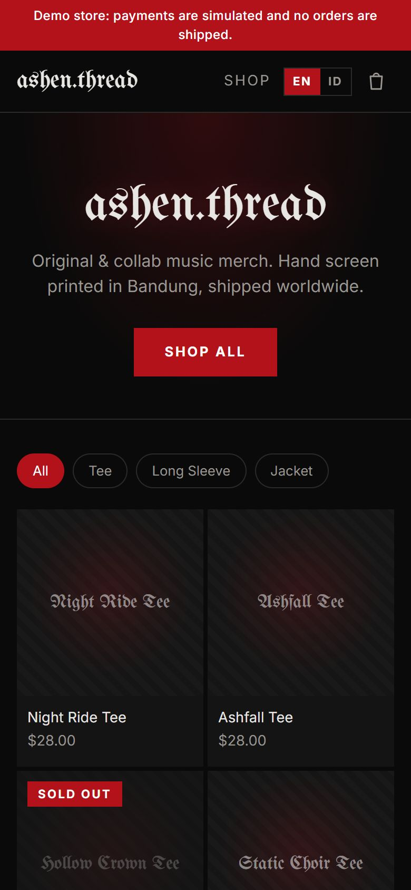
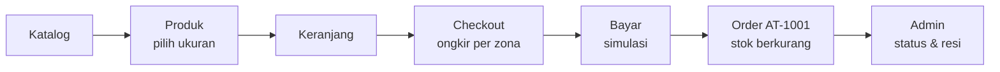

<h1 align="center">ashen.thread</h1>

<p align="center">
  <b>Demo toko online merch musik yang menjual ke pembeli dalam dan luar negeri.</b><br>
  Stok per ukuran, ongkir per zona negara, pembayaran simulasi, dan dashboard admin, semuanya berjalan di browser tanpa server.
</p>

<p align="center">
  
  
  <a href="https://github.com/khanigaraa/ashen-thread-store/actions/workflows/deploy.yml"></a>
  
</p>

<p align="center">
  <a href="https://khanigaraa.github.io/ashen-thread-store/"><b>Demo live</b></a> ·
  <a href="#fitur">Fitur</a> ·
  <a href="#tangkapan-layar">Tangkapan layar</a> ·
  <a href="#mulai-cepat">Mulai cepat</a> ·
  <a href="#dokumentasi">Dokumentasi</a> ·
  <a href="#english-summary">English</a>
</p>



## Tentang

**ashen.thread** adalah toko online untuk brand merch musik: kaos, long sleeve, dan jaket yang dijual ke pembeli di Indonesia maupun luar negeri, dengan harga dalam USD dan dua bahasa (English / Indonesia).

- **Status:** demo portofolio. *ashen.thread* adalah brand fiktif, dan semua produk, harga, serta kontak di dalamnya hanya contoh.
- **Pembayaran:** hanya simulasi. Tidak ada uang atau data kartu yang diproses.
- **Yang tidak ada:** backend dan database. Data disimpan di `localStorage` browser, jadi setiap pengunjung punya tokonya sendiri. Apa saja yang dibutuhkan untuk berjualan sungguhan ada di [docs/MENUJU-PRODUKSI.md](docs/MENUJU-PRODUKSI.md).

## Fitur

| Bagian | Yang bisa dicoba |
|---|---|
| **Katalog** | Grid bergaya feed Instagram, filter kategori (Tee, Long Sleeve, Jacket), dan label **SOLD OUT** |
| **Detail produk** | Beberapa foto, ukuran S–XXL, ukuran habis otomatis nonaktif, peringatan "tinggal N", dan size chart (cm & inci) |
| **Keranjang** | Tetap tersimpan saat halaman dimuat ulang, dan jumlahnya tidak bisa melebihi stok ukuran itu |
| **Checkout** | Validasi form, ongkir otomatis per zona negara (Standard / Express), dan catatan bea masuk |
| **Pembayaran** | PayPal / kartu (simulasi) sampai halaman "Order berhasil" dengan nomor pesanan `AT-1001` dan seterusnya |
| **Dua bahasa** | English / Indonesia, bisa diganti kapan saja |
| **Halaman info** | About, Shipping, Exchange Policy, dan Contact |
| **Admin: pesanan** | Ubah status (New → Packed → Shipped → Completed, atau Cancelled), isi nomor resi, dan pratinjau email konfirmasi |
| **Admin: produk** | Tambah, edit, sembunyikan, atur stok per ukuran, dan upload foto |
| **Admin: dashboard** | Pesanan baru, total penjualan, peringatan stok, dan tombol reset data demo |

## Tangkapan layar

| | |
|---|---|
|  |  |
|  |  |

Semua gambar di atas diambil otomatis dari demo live dengan `npm run screenshots`.

## Alur pembelian



Alur ini juga yang diuji oleh tes end-to-end, dari memilih ukuran sampai pesanan muncul di admin.

## Arsitektur

Logika toko (`src/core/`) dipisah dari tampilan (`src/ui/`). Semua akses data lewat satu *storage adapter* (`src/core/storage.ts`), jadi `localStorage` bisa diganti dengan backend sungguhan tanpa mengubah logika keranjang, stok, ongkir, dan pesanan. Detail lengkap, termasuk tabel tarif ongkir per zona, ada di [docs/ARSITEKTUR.md](docs/ARSITEKTUR.md).

| Lapisan | Teknologi |
|---|---|
| Tampilan | TypeScript murni, CSS, router hash buatan sendiri |
| Logika toko | TypeScript murni, tanpa DOM, diuji dengan Vitest |
| Penyimpanan | `localStorage` lewat adapter |
| Tes | Vitest (84 unit test), Playwright (end-to-end) |
| Hosting | GitHub Pages, deploy otomatis lewat GitHub Actions setelah tes lolos |

## Mulai cepat

Butuh **Node.js 18 atau lebih baru** (diuji dengan Node 26).

```bash
npm install
npm run dev        # http://localhost:5173
```

Untuk masuk ke admin, buka `#/admin` lalu pakai login demo (juga ditampilkan di halaman login):

- Email: `admin@ashenthread.test`
- Kata sandi: `demo-ashen`

## Pengujian

```bash
npm test            # 84 unit test (Vitest)
npm run test:e2e    # alur beli sampai admin (Playwright, memakai Microsoft Edge)
npm run build       # cek TypeScript + build produksi
```

Isi setiap file tes ada di [docs/PENGUJIAN.md](docs/PENGUJIAN.md).

## Toko custom atau Shopify?

Toko yang dibuat khusus seperti ini cocok kalau:

- tampilan dan alurnya harus benar-benar mengikuti brand, misalnya katalog bergaya feed Instagram, stok per ukuran, atau tarif ongkir per zona negara yang ditentukan sendiri;
- kamu ingin kode dan datanya milik sendiri, tanpa biaya langganan platform per bulan.

Shopify, WooCommerce, atau marketplace lebih masuk akal kalau:

- toko harus jalan secepatnya tanpa developer;
- kamu butuh banyak integrasi siap pakai, seperti payment gateway lokal, ekspedisi, atau sinkron ke marketplace;
- tidak ada orang yang akan merawat kode dan servernya.

## Struktur repositori

```text
src/
  core/         logika toko: produk, stok, keranjang, ongkir, pesanan, admin (+ unit test)
  ui/           router, halaman, terjemahan EN/ID, email, gaya
e2e/            tes end-to-end Playwright
scripts/        screenshot README
docs/           dokumentasi dan gambar README
.github/        workflow deploy ke GitHub Pages
```

## Dokumentasi

| Dokumen | Isi |
|---|---|
| [ARSITEKTUR.md](docs/ARSITEKTUR.md) | Pemisahan core/ui, storage adapter, router, tabel tarif ongkir per zona |
| [PENGUJIAN.md](docs/PENGUJIAN.md) | Isi 84 unit test dan langkah tes end-to-end |
| [MENUJU-PRODUKSI.md](docs/MENUJU-PRODUKSI.md) | Bagian yang masih simulasi dan apa yang dibutuhkan untuk berjualan sungguhan |

## Mau dibuatkan toko online?

Saya menerima pesanan website: toko online, landing page, company profile, portofolio, sampai aplikasi web. Hubungi saya lewat [LinkedIn](https://www.linkedin.com/in/kantakhanigara) atau DM [Instagram @khanigaraa](https://www.instagram.com/khanigaraa).

## Lisensi

[MIT](LICENSE) © 2026 Kanta Khanigara

---

## English summary

**ashen.thread** is a demo online store for a fictional music-merch brand that sells to buyers in Indonesia and abroad. It has a catalogue with per-size stock, a cart, a checkout with shipping rates by country zone, a simulated PayPal/card payment, and an admin dashboard for orders and products. Everything runs in the browser with no server: data lives in `localStorage` behind a storage adapter, so a real backend can replace it without touching the shop logic.

Built with vanilla TypeScript and Vite. Tested with 84 Vitest unit tests and a Playwright end-to-end test. MIT licensed. [Try the live demo](https://khanigaraa.github.io/ashen-thread-store/).
