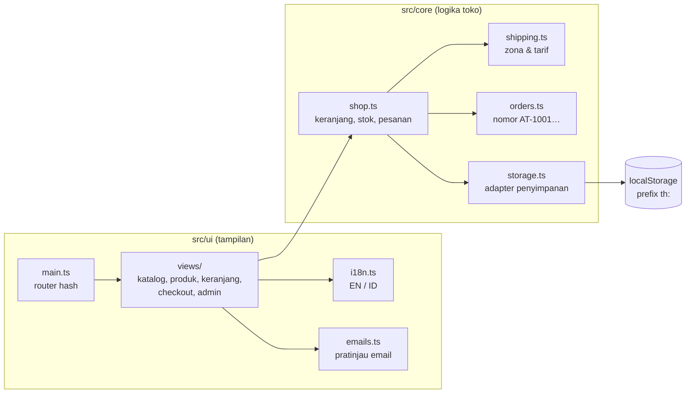

# Arsitektur

Toko ini aplikasi satu halaman (SPA) yang berjalan **sepenuhnya di browser**: TypeScript murni tanpa framework UI, dibangun dengan Vite, dan di-deploy sebagai file statis ke GitHub Pages.

## Dua lapisan yang dipisah

| Lapisan | Folder | Isi | Tahu soal DOM? |
|---|---|---|---|
| Logika toko | `src/core/` | Produk, stok per ukuran, keranjang, ongkir, pesanan, login admin, dashboard | Tidak |
| Tampilan | `src/ui/` | Router, halaman, terjemahan, email, gaya | Ya |

Semua aturan bisnis ada di `src/core/` dan diuji tanpa browser. Contohnya, jumlah di keranjang tidak boleh melebihi stok ukuran itu (`shop.ts`), dan ukuran yang stoknya 0 otomatis tidak bisa dipilih.

## Penyimpanan

`src/core/storage.ts` adalah *adapter*: satu-satunya tempat yang membaca dan menulis data. Saat ini ia memakai `localStorage` dengan prefix `th:`, jadi pesanan dari checkout langsung muncul di dashboard admin **di browser yang sama**.

Karena logika toko hanya berbicara dengan adapter ini, penyimpanan browser bisa diganti dengan API backend tanpa mengubah logika keranjang, stok, dan pesanan. Langkah ke sana ada di [MENUJU-PRODUKSI.md](MENUJU-PRODUKSI.md).

## Router

Router memakai hash URL (`#/…`) supaya bisa jalan di GitHub Pages tanpa konfigurasi server. `src/ui/main.ts` membagi rute jadi dua:

| Rute | Bagian |
|---|---|
| `#/`, `#/shop`, `#/product/:slug`, `#/cart`, `#/checkout`, `#/payment`, `#/order/:nomor`, `#/about`, `#/shipping`, `#/exchange`, `#/contact` | Toko |
| `#/admin` dan `#/admin/…` | Admin (dashboard, pesanan, produk) |

## Ongkos kirim

Semua tarif ada di satu tempat (`src/core/shipping.ts`), jadi checkout dan halaman Shipping membaca angka yang sama. Tarif ini contoh untuk demo, dalam USD:

| Zona | Contoh negara | Standard (item pertama / tambahan) | Express | Estimasi |
|---|---|---|---|---|
| Domestik | Indonesia | $3 / $0 | — | 2–5 hari |
| Zona 1 | MY, SG, TH, PH | $8 / $3 | $25 / $6 | 7–14 hari (Express 3–5) |
| Zona 2 | JP, KR, AU | $12 / $4 | $35 / $8 | 10–21 hari (Express 3–6) |
| Zona 3 | US, CA, GB, DE | $15 / $5 | $45 / $10 | 14–28 hari (Express 4–7) |
| Zona 4 | Timur Tengah, Afrika, lainnya | $18 / $6 | $55 / $12 | 14–35 hari (Express 5–10) |

Checkout juga menampilkan catatan bahwa bea masuk dan pajak di negara tujuan dibayar pembeli saat barang tiba.
